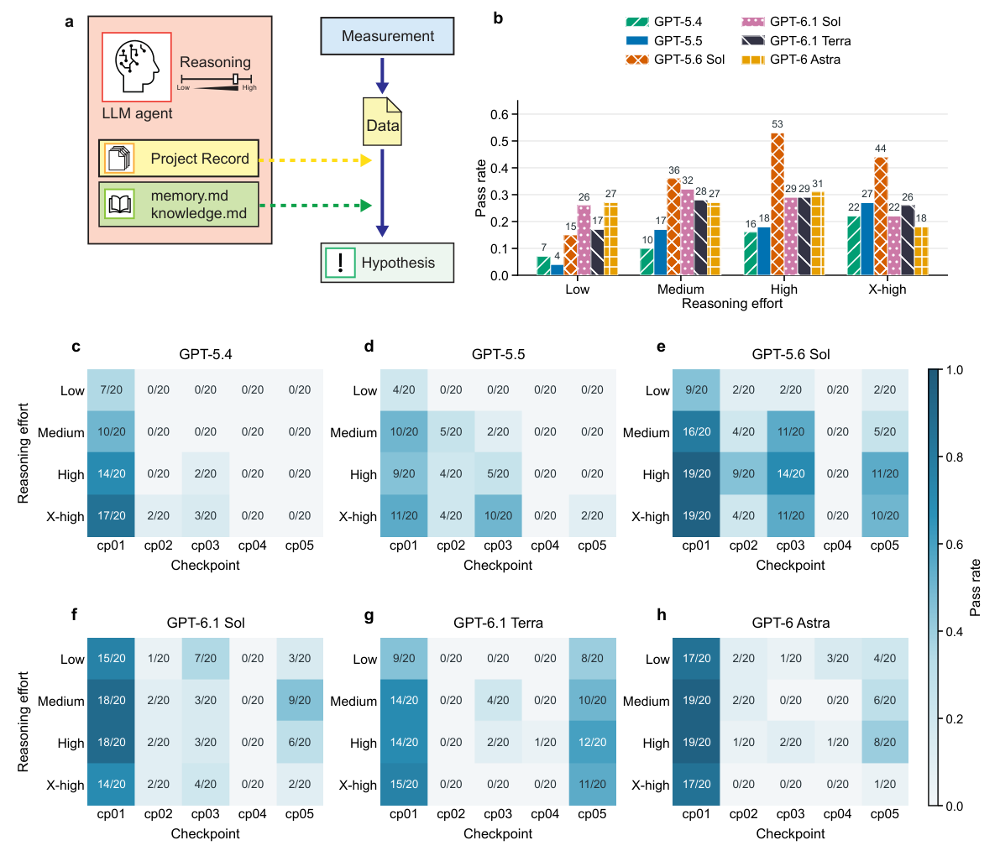
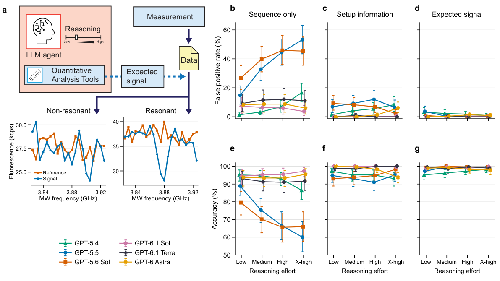
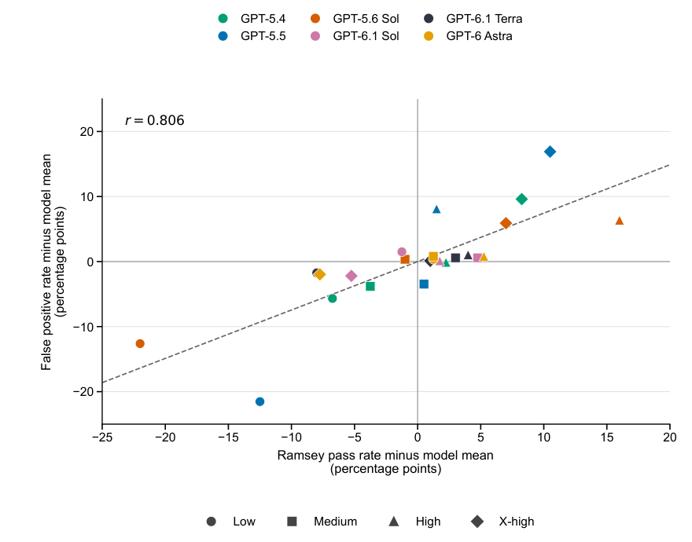

# NV Autonomous Experiments

## Overview

This repository contains the data and code accompanying a manuscript on an
LLM agent for autonomous experiments with nitrogen-vacancy centers. OpenClaw
ran the agent and managed the experimental project.

The manuscript has two connected contributions.  First, it demonstrates an
autonomous experimental workflow that combines persistent project records,
quantitative calculation and data analysis tools, and deterministic experiment
control.  Second, it evaluates scientific reasoning separately from laboratory
execution through Ramsey checkpoint and pODMR data evaluation benchmarks.

The release contains completed project records, evidence logs, bridge records,
figures, reports, benchmark inputs, labels, predictions, per run analysis notes,
LLM-judge outputs, human validation labels, previous scores, and analysis code
needed to check the reported results.

## Paper and Repository Map

The order below follows the current manuscript.

| Manuscript component | What it shows | Repository entry point |
| --- | --- | --- |
| Figure 1. Autonomous NV workflow | The boundary between LLM reasoning, persistent project state, analysis tools, deterministic validation, and hardware control | [System overview](docs/system_overview.md), [runtime architecture](docs/runtime_architecture.md) |
| Figure 2. Main autonomous experiment | Measurements and decisions during the main autonomous experiment | [Main experiment `image172647`](cases/image172647/README.md) |
| Figure 3. Ramsey checkpoint benchmark | Whether six models identify a possible error in the calibrated resonance frequency | [Six-model results and figure code](benchmarks/additional-models-2026-10/), [original three-model records](benchmarks/three-model-comparison-2026-07/ramsey/) |
| Figure 4. pODMR benchmark | Effects of prompts, reasoning effort, and model identity on resonance judgments across six models | [Six-model results and figure code](benchmarks/additional-models-2026-10/), [original three-model records](benchmarks/three-model-comparison-2026-07/podmr/) |
| Figure 5. Relationship between the benchmarks | Ramsey pass rates and pODMR false positive rates after subtracting each model's mean | [Analysis and figures](benchmarks/additional-models-2026-10/reproduced/main_figures/) |
| Supplementary case studies and analyses | Two additional completed autonomous runs, representative pODMR inputs, deterministic checks, and detailed benchmark tables | [Additional cases](cases/README.md), [benchmark records](benchmarks/three-model-comparison-2026-07/README.md) |
| Supplementary Note 4. Human reference workflow | Archived human NV selection and characterization from September 2023, with the experimental purpose and selection criteria | [Original log and context](human_reference/2023-09_nv_selection/README.md) |
| Supplementary Note 5. Ramsey judge validation | 96% agreement and the confusion matrix | [Judge and validation records](benchmarks/three-model-comparison-2026-07/ramsey/llm_judge/) |
| Supplementary Note 6. Further benchmark analyses | Execution environments, observed rates, and correlations within models | [Evaluation records and analysis](benchmarks/additional-models-2026-10/) |

## Public Scope

The repository provides experimental records and code for inspection and
offline analysis. Hardware execution is disabled. See
[Public scope](docs/public_scope.md) for what is included and excluded.

## Autonomous Experiment Records

The main experiment in the manuscript is `image172647`. The agent acquired a
new image, screened candidate NV centers with pODMR, refined the resonance
calibration, and acquired Ramsey measurements at multiple detunings. It then
used an N=8 CPMG measurement to investigate a possible carbon-13 contribution
to the weak frequency components in the Ramsey spectra. The released project
folder records the data, decisions, analyses, and final interpretation.

| Case | Role in the manuscript |
| --- | --- |
| [`image172647`](cases/image172647/README.md) | Main autonomous experiment described above |
| [`image145844`](cases/image145844/README.md) | Additional case in which human advice led the agent to reanalyze the Ramsey data |
| [`image231924`](cases/image231924/README.md) | Additional case in which the agent estimated `T2*` after recovering from a failed measurement |

## Offline Benchmarks

We evaluated GPT-5.4, GPT-5.5, GPT-5.6 Sol, GPT-6.1 Sol, GPT-6.1 Terra,
and GPT-6 Astra using the same input files, prompts, reasoning effort settings,
number of replicates, and scoring rules. Records are split between the
[original three models](benchmarks/three-model-comparison-2026-07/README.md)
and the [three models added in October](benchmarks/additional-models-2026-10/).
The latter directory also contains the combined results and documents the
differences in execution environments.

| Benchmark | Design | Total size |
| --- | --- | ---: |
| [Ramsey checkpoint benchmark](benchmarks/additional-models-2026-10/) | Five chronological checkpoints, four reasoning effort settings, and twenty replicates per checkpoint and effort for each model | 2,400 responses |
| [pODMR data evaluation benchmark](benchmarks/additional-models-2026-10/) | 96 measurements from two NV centers, three prompts, four reasoning effort settings, and three replicates for each model | 20,736 judgments |

Every model has 400 Ramsey responses and 3,456 pODMR judgments.
Across the four settings within each model, higher Ramsey pass rates tended
to accompany higher false positive rates when the pODMR task provided only
pulse sequence information alongside the measurement data. Figure 5 shows
this relationship after subtracting each model's mean across the four settings.

### Ramsey checkpoint benchmark

The Ramsey task tests whether the agent can use project records and new
Ramsey data to identify a possible residual error in the calibrated resonance
frequency. Analysis, measurements, and human advice from after each checkpoint
were excluded from the files supplied to the agent.

| Model | Low | Medium | High | X-high |
| --- | ---: | ---: | ---: | ---: |
| GPT-5.4 | 7/100 | 10/100 | 16/100 | 22/100 |
| GPT-5.5 | 4/100 | 17/100 | 18/100 | 27/100 |
| GPT-5.6 Sol | 15/100 | 36/100 | 53/100 | 44/100 |
| GPT-6.1 Sol | 26/100 | 32/100 | 29/100 | 22/100 |
| GPT-6.1 Terra | 17/100 | 28/100 | 29/100 | 26/100 |
| GPT-6 Astra | 27/100 | 27/100 | 31/100 | 18/100 |

These results use the fixed GPT-6.1 Sol/high LLM judge. Human validation
gave 96/100 agreement (Cohen's kappa 0.901).
The [judge release](benchmarks/three-model-comparison-2026-07/ramsey/llm_judge/)
contains scores for the original three models, prompts, validation records,
and a comparison with the unchanged previous scores. Scores for the other
three models are in the [additional evaluations](benchmarks/additional-models-2026-10/ramsey/).



### pODMR data evaluation benchmark

The pODMR task contains 96 measurements from two NV centers: 24 from one NV
whose targeted transition lay within the scanned frequency range and 72 from
another whose targeted transition lay outside that range. These were labeled
as resonance present and absent, respectively. Each agent judged one unlabeled
measurement at a time using one of three prompts.

| Prompt | Information available to the agent |
| --- | --- |
| Sequence only | Raw export, raw readout figure, and pulse sequence information |
| Setup information | Sequence information plus experimental setup information |
| Expected signal | Setup information plus a requirement to calculate the expected signal before judging whether a resonance is present |

With the sequence only prompt, false positive rates did not consistently
increase with reasoning effort across the six models. Requiring an expected
signal calculation kept false positive rates between 0 and 3.70 percent
across all six models and all reasoning settings. Astra's false positive
rates with this prompt ranged from 0 to 1.39 percent.

Complete point estimates, confidence intervals obtained by bootstrap resampling
of measurements, predictions, and analysis notes are available from the
[combined results](benchmarks/additional-models-2026-10/data/podmr_summary.json)
and the two record directories linked above.





Representative pODMR measurements used in the Supplementary Information are
available in the [original benchmark records](benchmarks/podmr-model-first-resonance-2026-05/README.md).

## Repository Layout

```text
cases/
  image145844/
  image172647/
  image231924/
benchmarks/
  additional-models-2026-10/
    data/
    podmr/
    ramsey/
    reproduced/main_figures/
  three-model-comparison-2026-07/
    models/
      gpt-5.4/
      gpt-5.5/
      gpt-5.6-sol/
    figures/
    ramsey/
    podmr/
  nv-checkpoint-review-2026-06/
    inputs/
    labels/
    prompts/
    results/
  podmr-model-first-resonance-2026-05/
    inputs/
    labels/
    prompts/
    results/
python/
  openclaw_runtime/
  openclaw_nv_execution_source/
matlab/
  analysis/
  manifests/
  sequences/
tools/
docs/
```

## Documentation and Source Map

| Topic | Entry point |
| --- | --- |
| Public boundary | [docs/public_scope.md](docs/public_scope.md), [docs/source_release_boundary.md](docs/source_release_boundary.md) |
| System architecture | [docs/system_overview.md](docs/system_overview.md), [docs/runtime_architecture.md](docs/runtime_architecture.md) |
| Model and agent configuration | [Model settings and links to all six models](docs/model_and_agent_configuration.md) |
| Case guide | [docs/case_walkthrough.md](docs/case_walkthrough.md), [cases/README.md](cases/README.md) |
| Memory and knowledge | [docs/memory_knowledge.md](docs/memory_knowledge.md), [docs/nv_research_memory.md](docs/nv_research_memory.md), [docs/nv_research_knowledge_index.md](docs/nv_research_knowledge_index.md) |
| Project state and intents | [docs/project_state_template.md](docs/project_state_template.md), [docs/experiment_intent_schema.md](docs/experiment_intent_schema.md) |
| Code and safety | [docs/code_inventory.md](docs/code_inventory.md), [docs/safety_boundary.md](docs/safety_boundary.md) |
| Source provenance | [SOURCE_PROVENANCE.md](SOURCE_PROVENANCE.md) |

## Reproducibility

The released records support audit, offline analysis, and reconstruction of the
reported benchmark values and selected figures.

The quantitative panels and final layouts of manuscript Figs. 3–5 can be
reproduced from the released source tables and vector artwork. See the
[current figure instructions](benchmarks/additional-models-2026-10/#reproduce-the-analysis-and-figures).
The [earlier figure guide](benchmarks/three-model-comparison-2026-07/REPRODUCE_FIGURES.md)
preserves the original three-model workflow.

## License

Code is licensed under the MIT License.  Documentation, public case folders,
data exports, generated figures, reports, and analysis artifacts are licensed
under CC BY 4.0.  See [LICENSE](LICENSE).

## Citation

Citation metadata is provided in [CITATION.cff](CITATION.cff).
