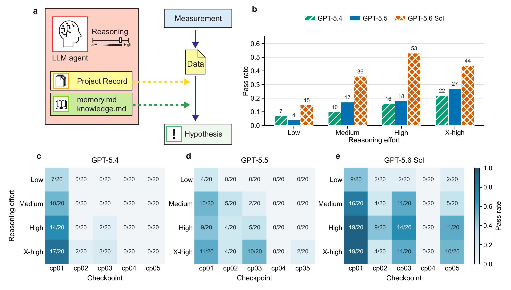
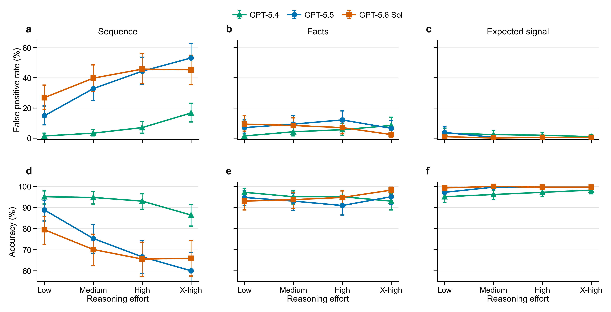

# NV Autonomous Experiments

## Overview

This repository contains the data and code accompanying a manuscript on an
LLM agent for autonomous nitrogen-vacancy center experiments.  The OpenClaw
platform provided the agent and project management layer around the NV
instrument control stack.

The manuscript has two connected contributions.  First, it demonstrates an
autonomous experimental workflow that combines persistent project records,
quantitative calculation and data analysis tools, and deterministic experiment
control.  Second, it evaluates scientific reasoning separately from laboratory
execution through Ramsey checkpoint and pODMR data evaluation benchmarks.

The release contains completed project records, evidence logs, bridge records,
figures, reports, benchmark inputs, labels, predictions, per run analysis notes,
LLM-judge outputs, human validation labels, previous scores, and analysis code
needed to check the reported results.

## Paper and Repository Map

The order below follows the current manuscript.

| Manuscript component | What it shows | Repository entry point |
| --- | --- | --- |
| Figure 1. Autonomous NV workflow | The boundary between LLM reasoning, persistent project state, analysis tools, deterministic validation, and hardware control | [System overview](docs/system_overview.md), [runtime architecture](docs/runtime_architecture.md) |
| Figure 2. Main autonomous experiment | NV candidate selection, pODMR screening and calibration, Ramsey measurements, and a CPMG measurement to investigate a possible carbon-13 contribution to the weak frequency components in the Ramsey spectra | [Main experiment `image172647`](cases/image172647/README.md) |
| Figure 3. Ramsey checkpoint benchmark | Whether GPT-5.4, GPT-5.5, and GPT-5.6 Sol identify a possible error in the calibrated resonance frequency | [Three model Ramsey comparison](benchmarks/three-model-comparison-2026-07/ramsey/) |
| Figure 4. pODMR benchmark | Effects of prompts, reasoning effort, and model identity on resonance judgments | [Three model pODMR comparison](benchmarks/three-model-comparison-2026-07/podmr/) |
| Supplementary case studies and analyses | Two additional completed autonomous runs, representative pODMR inputs, deterministic checks, and detailed benchmark tables | [Additional cases](cases/README.md), [benchmark records](benchmarks/three-model-comparison-2026-07/README.md) |
| Supplementary Note 4. Human reference workflow | Archived human NV selection and characterization from September 2023, with the experimental purpose and selection criteria | [Original log and context](human_reference/2023-09_nv_selection/README.md) |
| Supplementary Note 5. Ramsey judge validation | 96% agreement and the confusion matrix | [Judge and validation records](benchmarks/three-model-comparison-2026-07/ramsey/llm_judge/) |

## Public Scope

The repository provides experimental records and code for inspection and
offline analysis. Hardware execution is disabled. See
[Public scope](docs/public_scope.md) for what is included and excluded.

## Autonomous Experiment Records

The main experiment in the manuscript is `image172647`. The agent acquired a
new image, screened candidate NV centers with pODMR, refined the resonance
calibration, and acquired Ramsey measurements at multiple detunings. It then
used an N=8 CPMG measurement to investigate a possible carbon-13 contribution
to the weak frequency components in the Ramsey spectra. The released project
folder records the data, decisions, analyses, and final interpretation.

| Case | Role in the manuscript | Summary | Status |
| --- | --- | --- | --- |
| [`image172647`](cases/image172647/README.md) | Main autonomous workflow demonstration | New imaging after loss of the initial candidate, candidate selection, pODMR calibration, Ramsey measurements at multiple detunings, and a CPMG N=8 check | Completed |
| [`image145844`](cases/image145844/README.md) | Additional case study | Aligned NV selection, pODMR screening, repeated Ramsey diagnostics, and later frequency reanalysis | Completed |
| [`image231924`](cases/image231924/README.md) | Additional case study | Aligned NV selection, resonant frequency refinement, a repeated Ramsey measurement, and a final report on the `T2*` estimate and its limitations | Completed |

## Offline Benchmarks

Both benchmarks were evaluated with GPT-5.4, GPT-5.5, and GPT-5.6 Sol using the
same inputs, prompts, reasoning effort settings, replicate structure, and
scoring rules for each model. Model identifiers, execution dates, and links
to each model's records are listed in the
[model comparison](benchmarks/three-model-comparison-2026-07/README.md).

| Benchmark | Design | Total size |
| --- | --- | ---: |
| [Ramsey checkpoint benchmark](benchmarks/three-model-comparison-2026-07/ramsey/) | Five chronological checkpoints, four reasoning effort settings, and twenty replicates per checkpoint and effort for each model | 1,200 runs |
| [pODMR data evaluation benchmark](benchmarks/three-model-comparison-2026-07/podmr/) | 96 measurements from two NV centers, three prompts, four reasoning effort settings, and three replicates for each model | 10,368 decisions |

### Ramsey checkpoint benchmark

The Ramsey task tests whether the agent can use project records and new
Ramsey data to identify a possible residual error in the calibrated resonance
frequency. Analysis, measurements, and human advice from after each checkpoint
were excluded from the files supplied to the agent.

| Model | Low | Medium | High | X-high |
| --- | ---: | ---: | ---: | ---: |
| GPT-5.4 | 7/100 | 10/100 | 16/100 | 22/100 |
| GPT-5.5 | 4/100 | 17/100 | 18/100 | 27/100 |
| GPT-5.6 Sol | 15/100 | 36/100 | 53/100 | 44/100 |

These results use the fixed GPT-6.1 Sol/high LLM judge. Human validation
gave 96/100 agreement (Cohen's kappa 0.901).
The [judge release](benchmarks/three-model-comparison-2026-07/ramsey/llm_judge/)
contains all scores, prompts, validation records, and a comparison with the
unchanged previous scores.



### pODMR data evaluation benchmark

The pODMR task contains 96 measurements from two NV centers: 24 from one NV
whose targeted transition lay within the scanned frequency range and 72 from
another whose targeted transition lay outside that range. These were labeled
as resonance present and absent, respectively. Each agent judged one unlabeled
measurement at a time using one of three prompts.

| Prompt | Information available to the agent |
| --- | --- |
| Sequence | Raw export, raw readout figure, and pulse sequence information |
| Facts | Sequence information plus compact experimental setup facts |
| Expected signal | Facts plus a requirement to calculate the expected signal before judging resonance presence |

Sequence information alone produced more false positive resonance judgments at
higher reasoning effort.  Requiring an expected signal calculation kept the
false positive rate between 0 and 3.70 percent across all three models and all
reasoning settings.  GPT-5.5 produced no false negatives.  GPT-5.6 Sol produced
one false negative at low reasoning with the sequence prompt.  GPT-5.4 produced
between two and eleven false negatives among 72 resonance present decisions in
each prompt and reasoning cell.

Complete point estimates, confidence intervals obtained by bootstrap resampling
of measurements, predictions, and analysis notes are available from the
[pODMR comparison directory](benchmarks/three-model-comparison-2026-07/podmr/).



Representative pODMR measurements used in the Supplementary Information are
available in the [original benchmark records](benchmarks/podmr-model-first-resonance-2026-05/README.md).

## Repository Layout

```text
cases/
  image145844/
  image172647/
  image231924/
benchmarks/
  three-model-comparison-2026-07/
    models/
      gpt-5.4/
      gpt-5.5/
      gpt-5.6-sol/
    figures/
    ramsey/
    podmr/
  nv-checkpoint-review-2026-06/
    inputs/
    labels/
    prompts/
    results/
  podmr-model-first-resonance-2026-05/
    inputs/
    labels/
    prompts/
    results/
python/
  openclaw_runtime/
  openclaw_nv_execution_source/
matlab/
  analysis/
  manifests/
  sequences/
tools/
docs/
```

## Documentation and Source Map

| Topic | Entry point |
| --- | --- |
| Public boundary | [docs/public_scope.md](docs/public_scope.md), [docs/source_release_boundary.md](docs/source_release_boundary.md) |
| System architecture | [docs/system_overview.md](docs/system_overview.md), [docs/runtime_architecture.md](docs/runtime_architecture.md) |
| Model and agent configuration | [docs/model_and_agent_configuration.md](docs/model_and_agent_configuration.md), [three model run conditions](benchmarks/three-model-comparison-2026-07/run_conditions.json) |
| Case guide | [docs/case_walkthrough.md](docs/case_walkthrough.md), [cases/README.md](cases/README.md) |
| Memory and knowledge | [docs/memory_knowledge.md](docs/memory_knowledge.md), [docs/nv_research_memory.md](docs/nv_research_memory.md), [docs/nv_research_knowledge_index.md](docs/nv_research_knowledge_index.md) |
| Project state and intents | [docs/project_state_template.md](docs/project_state_template.md), [docs/experiment_intent_schema.md](docs/experiment_intent_schema.md) |
| Code and safety | [docs/code_inventory.md](docs/code_inventory.md), [docs/safety_boundary.md](docs/safety_boundary.md) |
| Source provenance | [SOURCE_PROVENANCE.md](SOURCE_PROVENANCE.md) |

## Reproducibility

The released records support audit, offline analysis, and reconstruction of the
reported benchmark values and selected figures.

The quantitative panels and final layouts of manuscript Figs. 3 and 4 can be
reproduced from the released source tables and vector artwork.  See the
[figure reproduction guide](benchmarks/three-model-comparison-2026-07/REPRODUCE_FIGURES.md)
for the environment, commands, inputs, and expected outputs.

## License

Code is licensed under the MIT License.  Documentation, public case folders,
data exports, generated figures, reports, and analysis artifacts are licensed
under CC BY 4.0.  See [LICENSE](LICENSE).

## Citation

Citation metadata is provided in [CITATION.cff](CITATION.cff).
