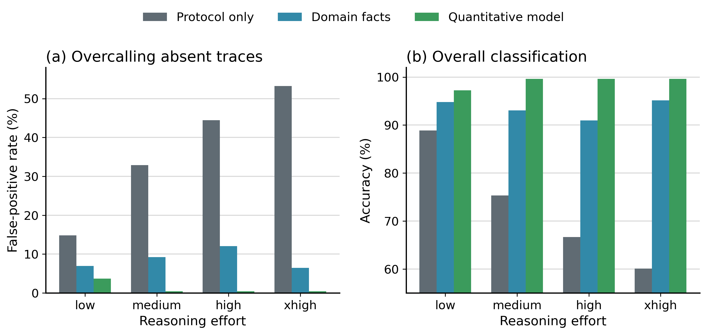

# pODMR Data Evaluation Benchmark

The agent is asked to determine whether a resonance is present in previously
acquired pODMR data. The benchmark tests how the prompt and reasoning effort
affect its judgments.

The dataset contains 96 strong-pi pODMR measurements from two NV centers:

- 24 resonance-present measurements from one NV center
- 72 resonance-absent measurements from the other NV center

The labels are defined by the physical measurement configuration.  The
resonance-present measurements were acquired from an NV center aligned with
the static magnetic field, whose targeted transition lay inside the scanned
frequency window. The resonance-absent measurements were acquired from the
other NV center, which had a different crystallographic orientation and whose
corresponding transition lay outside that window.
Failed acquisitions and tracking failures are excluded rather than labeled as
resonance absent.

The original evaluation used GPT-5.4, GPT-5.5, and GPT-5.6 Sol. Each
measurement was evaluated three times for every combination of model,
prompt, and reasoning setting (`low`, `medium`, `high`, and `xhigh`).
The current manuscript also includes GPT-6.1 Sol, GPT-6.1 Terra, and GPT-6 Astra;
see the
[six-model results and current figures](../additional-models-2026-10/).

## Main Results

The original GPT-5.5 reasoning-effort sweep is summarized in
`results/reasoning_effort_sweep_summary.md`.  The GPT-5.4 and GPT-5.6 Sol
records and the combined measurement bootstrap table are in the
[three model comparison release](../three-model-comparison-2026-07/README.md).



Example raw pODMR traces for one resonance-present case and one
resonance-absent case are shown below.  The figure plots the unnormalized
reference and signal readouts for each case.


The table below reports the original GPT-5.5 sweep.

| Reasoning | Prompt | TP | TN | FP | FN | Accuracy | False-positive rate | False-negative rate |
| --- | --- | ---: | ---: | ---: | ---: | ---: | ---: | ---: |
| low | Sequence | 72 | 184 | 32 | 0 | 88.9% | 14.81% | 0.00% |
| low | Facts | 72 | 201 | 15 | 0 | 94.8% | 6.94% | 0.00% |
| low | Expected signal | 72 | 208 | 8 | 0 | 97.2% | 3.70% | 0.00% |
| medium | Sequence | 72 | 145 | 71 | 0 | 75.3% | 32.87% | 0.00% |
| medium | Facts | 72 | 196 | 20 | 0 | 93.1% | 9.26% | 0.00% |
| medium | Expected signal | 72 | 215 | 1 | 0 | 99.7% | 0.46% | 0.00% |
| high | Sequence | 72 | 120 | 96 | 0 | 66.7% | 44.44% | 0.00% |
| high | Facts | 72 | 190 | 26 | 0 | 91.0% | 12.04% | 0.00% |
| high | Expected signal | 72 | 215 | 1 | 0 | 99.7% | 0.46% | 0.00% |
| xhigh | Sequence | 72 | 101 | 115 | 0 | 60.1% | 53.24% | 0.00% |
| xhigh | Facts | 72 | 202 | 14 | 0 | 95.1% | 6.48% | 0.00% |
| xhigh | Expected signal | 72 | 215 | 1 | 0 | 99.7% | 0.46% | 0.00% |

The expected signal prompt differs from the facts prompt by adding a
requirement to establish the expected physical signal with a simulation or
explicit quantitative model calculation before deciding whether a resonance is
present. For GPT-5.5, increasing reasoning effort increased false positive
rates with the sequence only prompt. The expected signal prompt kept false
positive rates low across reasoning settings in all three original models.

Non-LLM signal-processing baselines are summarized in
`results/non_llm_signal_baseline_summary.md`.

The appendix batch comparison, in which all 96 unlabeled measurements were
provided in one prompt, is summarized in
`results/batch_context_main_inputs_summary.md`.

## Reconstructed Per-Case Runner

`scripts/run_per_case.py` provides a provider-neutral reconstruction of the
per-case benchmark harness. It is based on the released inputs, prompts,
labels, scoring files, and batch runner. It is not claimed to be the exact
private runner used for the manuscript results.

Each request is launched from a workspace containing only one case:

- `raw_export.json`
- `raw_readouts.png`
- `sequence.xml`
- `case_metadata.json`
- `task.md`
- an initially empty `outputs/` directory

Labels and sibling cases are not copied into the workspace. Scoring against
`labels/gold_labels.csv` occurs only after the model process exits. Both Codex
and Claude are instructed to open `raw_readouts.png` from the workspace, so the
image-delivery method is held constant in a new cross-provider comparison.

Run a small Codex pilot:

```powershell
python scripts\run_per_case.py `
  --provider codex `
  --model "FULL_MODEL_ID" `
  --reasoning-effort low `
  --condition all `
  --replicates 1 `
  --limit 5 `
  --jobs 1 `
  --result-dir results\local\codex-pilot
```

Run the same pilot with Claude:

```powershell
python scripts\run_per_case.py `
  --provider claude `
  --model "FULL_MODEL_ID" `
  --reasoning-effort low `
  --condition all `
  --replicates 1 `
  --limit 5 `
  --jobs 1 `
  --max-budget-usd 10 `
  --result-dir results\local\claude-pilot
```

The Claude adapter uses `--safe-mode`, `--strict-mcp-config`,
`--no-session-persistence`, and JSON output. Confirm the available flags with
the installed Claude CLI before a paid run because CLI interfaces can change.
Use a full model id rather than a moving alias when the provider exposes one.

Every result directory receives `run_conditions.json`,
`model_outputs.jsonl`, `joined_predictions.csv`, and per-run analysis notes.
The conditions file records the CLI version, model argument, execution time,
prompt hashes, case-index hash, and image-delivery method. A template is
included as `run_conditions.example.json`. Use `--dry-run --limit 1` to inspect
one prepared workspace without invoking a model.

## Contents

- `inputs/`: agent-visible raw export JSON files and raw-readout figures.
- `labels/`: physical resonance labels used for scoring.
- `prompts/`: exact prompt text.
- `results/figures/`: benchmark summary figure as PNG and PDF.
- `results/`: Original GPT-5.5 predictions, summaries, and per-run analysis notes for
  `low`, `medium`, `high`, and `xhigh` reasoning efforts, plus tool use audit,
  deterministic baseline summaries, and the batch comparison used in the
  manuscript appendix.
- `scripts/`: isolated per-case execution, scoring, and package verification
  helpers.
- `../three-model-comparison-2026-07/`: GPT-5.4 and GPT-5.6 Sol predictions,
  notes, completion audits, and the combined three model summary.
